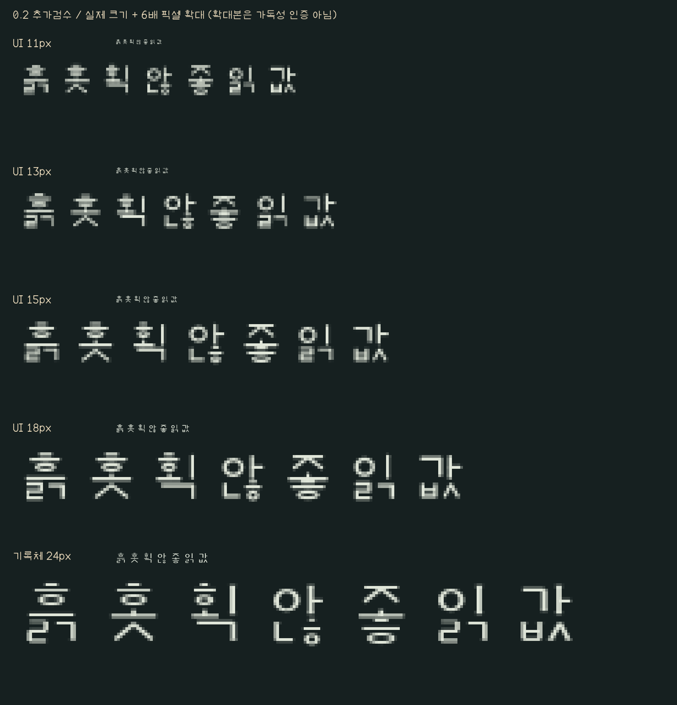

> 0.2 당시의 기록이다. 후속 수정·현재 범위는 [0.3 검수](TESTING.md)를 따른다.

# 0.2 추가 검수 — 2026-11-03

현재 판정은 **파일·대표 실행 검사를 통과한 시험판이며, 작은 UI의 실사용 검수는 완료되지 않음**이다. 앞서 제시한 UI 13px·본문 15~18px·기록체 24px는 대표 견본 기준이었다. 이를 검수 종료나 보편적인 최소 사용 크기로 해석하지 않도록 판정을 유보한다.

## 이번에 추가한 전체 한글 래스터 검사

Pillow 12.3.0 / FreeType 2.14.3에서 같은 정수 위치·기준선으로 글자마다 회색조 픽셀을 만들었다. 각 조건에서 현대 한글 11,172자를 검사했다. 총 8개 조건, 89,376회다. Windows 배율을 실제 변경한 검사는 아니다.

| 서체 | 크기(px) | 빈 글자 | 완전히 같은 회색조 글자 묶음 | 128 임계값에서 같아진 후보 묶음 |
|---|---:|---:|---:|---:|
| UI | 11 | 0 | 0 | 936 |
| UI | 13 | 0 | 0 | 302 |
| UI | 15 | 0 | 0 | 0 |
| UI | 18 | 0 | 0 | 160 |
| UI | 24 | 0 | 0 | 0 |
| 기록체 | 18 | 0 | 0 | 0 |
| 기록체 | 24 | 0 | 0 | 0 |
| 기록체 | 32 | 0 | 0 | 0 |

회색조의 0~255 값을 128 기준으로 둘로 나눈 검사는 가장자리 명도 차이를 제거한다. 후보 묶음 수는 **실제 화면에서 같은 글자가 됐다는 뜻도, 불량 개수도, 사용자 오독률도 아니다.** 0도 가독성 합격이 아니다. 다른 위치·크기·렌더러에서는 결과가 달라질 수 있다. 원시 결과와 파일 해시는 [small-size-validation.json](reviews/0.2-small-size-validation.json)에 있다.

## 아직 문제로 남은 표시

대표 글자의 실제 크기와 정수 배 확대본을 다시 비교했다. 작은 글자의 `ㅎ` 및 겹받침 내부 공간이 좁아지고 일부 획이 이어지는 사례가 남는다. 예를 들어 UI체 `흙`은 기존 연결 성분 검사에서 200px의 6개에 비해 15px에서는 4개였다. 이 숫자만으로 오독을 단정하지 않지만, 큰 크기에서 획이 분리됐다는 검사만으로 작은 본문의 판정을 끝낼 수 없다.

게임은 32px 글자 이미지를 더 작은 크기로 표시한다. 실제 게임 재실행에서도 작은 글자의 선이 고르지 않은 부분을 확인했다. 글꼴 원본과 게임 축소 표시를 각각 수정·재검수할 필요가 있다. 장문 견본은 추가했지만 실제 읽기 시간이나 피로도는 측정하지 않았다.

## 남은 검수

- [ ] 복잡한 초성·모음·받침의 작은 크기 설계와 표시 방식 보완.
- [ ] 게임 목록·검색·입력·설명문에서 실제 글자 크기와 잘림 검사.
- [ ] 실제 Windows 125/150/200% 배율의 표시·입력 검사. 창 크기 변경으로 대신하지 않음.
- [ ] 설치·제거·재시작 후 글꼴 이름과 문서 편집·PDF 내보내기 확인.
- [ ] 장문 가독성·오독·피로도와 다른 운영체제 확인.

이번 추가 검수에서는 TTF·배포 ZIP의 바이트를 변경하지 않았다. 기존 파일·구조 검사 결과는 그대로 유효한 범위가 있으나, 가독성까지 검수 완료한 것으로 표시하지 않는다.
