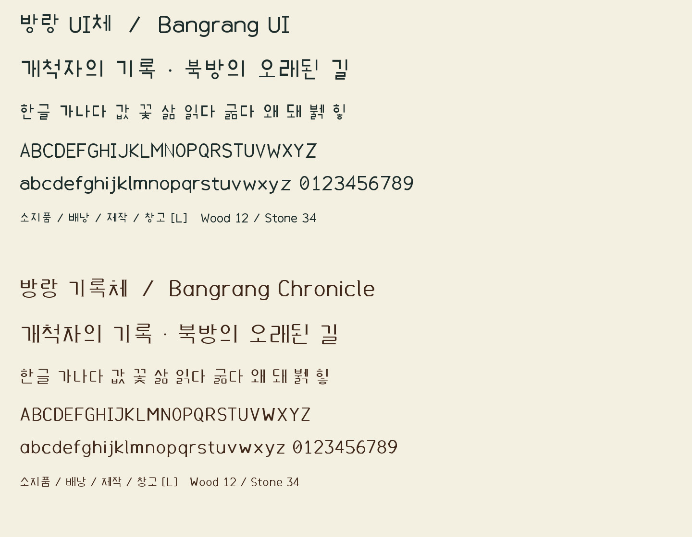

# 방랑 글꼴 — 0.2

방랑 UI체(Bangrang UI)와 방랑 기록체(Bangrang Chronicle)를 별도로 제작한 무료 글꼴이다. 0.2에서는 한글 획 겹침, 영문 간격, 문장부호와 기록체의 필획을 수정했다. Windows의 브라우저와 방랑 데모에서 대표 문장을 검수했다. 모든 문자·운영체제의 품질 인증을 의미하지 않으며, 공개 배포는 시험판으로 유지한다.

[0.2.0 다운로드](https://github.com/monodass-create/bangrang-fonts/releases/tag/v0.2.0) · [ZIP 바로 받기](https://github.com/monodass-create/bangrang-fonts/releases/download/v0.2.0/Bangrang-Fonts-0.2.0.zip) · [라이선스](OFL.txt)



## 두 서체

- **방랑 UI체:** 일정한 획과 둥근 끝을 사용한다. 압축된 초성·받침은 획 굵기와 간격을 별도로 조절한다.
- **방랑 기록체:** 가는 가로 획과 두꺼운 세로 획, 작은 끝 장식, 좁은 비례를 사용하는 제목·간판용 글꼴. 중세 분위기를 위한 현대 창작 서체이며, 실제 중세 한글 서체를 고증·복원한 것이 아니다.

두 파일 모두 Regular 한 굵기다. 가짜 볼드·기울임을 별도 완성 서체로 취급하지 않는다. 영문은 비례폭, 숫자는 수량 정렬을 위한 고정폭이며 일부 영문 쌍의 커닝을 포함한다.

| 용도 | 기존 견본 크기 — 사용 승인 기준 아님 |
|---|---|
| UI 버튼·짧은 목록 | 13px 이상 |
| 안내문·채팅·긴 한글 | 15~18px 이상 |
| 기록체 제목·간판 | 24px 이상 |

**2026-11-03 추가 검수로 위 최소 크기의 사용 적합성 판정을 유보했다.** 대표 견본에서 정한 수치였으며, 작은 한글의 획 접촉과 게임 축소 표시 검증이 충분하지 않았다. 전체 한글의 작은 래스터에 빈 글자·완전히 같은 회색조 결과는 없었지만, 이것은 글자가 편하게 읽힌다는 보증이 아니다. 특히 11~15px 복잡한 한글과 축소 UI에는 추가 수정·검수가 필요하다. 기록체의 작은 본문 사용도 권장하지 않는다. [추가 검수 결과](ADDITIONAL-REVIEW.md)를 먼저 확인한다.

## 포함 범위와 제작 출처

- 한글 완성형 U+AC00~U+D7A3 **11,172자**.
- 영문 대소문자·숫자·ASCII 인쇄 문자 **95자**(공백 포함).
- 현대 한글 자모, 일부 문장부호·화살표·원화 기호. 0.2에서 `× ÷ ± ° ℃ ✓ • é`를 추가했다.
- 전체 코드포인트와 파일 해시는 `build-report.json`에 기록한다.
- 한자·일본어·옛한글·확장 라틴 문자·모든 유니코드 기호를 지원하는 폰트는 아니다.

`source/build_fonts.py`에서 자모와 영문 선의 좌표, 획, 끝 장식, 조합 위치를 직접 정의했다. **기존 폰트의 윤곽을 읽거나 추출·변형하는 코드와 원본 폰트 파일은 포함하지 않는다.** 한글은 초성·중성·종성 조합 규칙으로 생성했다. 사람이 11,172자를 하나씩 별도 디자인하고 검수한 결과라는 뜻은 아니다.

사용 도구는 fontTools와 Pillow다. 도구 자체의 소스·바이너리는 배포물에 포함하지 않는다. 폰트 생성 원본은 fontTools로 TrueType 파일을 만들고, Pillow는 완성 파일의 견본을 렌더링하는 데 사용한다.

## 무료 사용·수정·배포

폰트 파일과 제작 원본은 **SIL Open Font License 1.1**로 제공한다. Reserved Font Name은 지정하지 않는다. 공식 조건은 함께 제공하는 `OFL.txt`를 따른다.

- 개인·상업 작업, 게임·방송·문서·웹사이트에 사용 가능.
- 폰트 수정과 재배포 가능. 폰트와 수정본의 배포에는 OFL 조건과 고지를 유지한다.
- 폰트 자체만 따로 판매하는 것은 허용하지 않는다.
- 이 글꼴로 만든 그림·문서·게임 전체를 OFL로 공개해야 한다는 뜻은 아니다.

근거: [SIL OFL 공식 원문](https://openfontlicense.org/open-font-license-official-text/), [사용 안내](https://openfontlicense.org/how-to-use-ofl-fonts/).

현재 저작자 표기는 프로젝트 명칭인 `The Bangrang Font Project Authors`다. 별도 개인 이름·상표 등록·독점적 권리 보장을 주장하지 않는다.

## 사용

`fonts/`의 TTF 파일을 사용한다. Windows에서는 파일을 열어 설치할 수 있으며, 게임·편집 프로그램에 직접 지정해 사용할 수도 있다. 이번 작업에서 사용자 시스템에 자동 설치하지 않았다.

웹·앱에서 폰트 이름은 `Bangrang UI`, `Bangrang Chronicle`이다. 언어별 이름을 읽는 프로그램은 방랑 UI체·방랑 기록체로 표시할 수 있다. 본문과 제목에 서체를 명시하여 시스템 대체 글꼴과 섞이지 않게 한다.

## 재생성

Python 환경에 `source/requirements.txt`의 의존성을 설치한 뒤 프로젝트 폴더에서 실행한다.

```text
python source/build_fonts.py
python source/make_specimens.py
python source/validate_fonts.py
```

첫 명령은 두 TTF와 `build-report.json`, 두 번째 명령은 견본과 `validation.json`, 세 번째 명령은 회귀 검사 결과 `regression-validation.json`을 만든다. 빌드 시간 필드 등으로 재생성 파일의 바이트 해시는 달라질 수 있으므로 해시를 디자인 동일성의 유일한 기준으로 사용하지 않는다.

## 검수 범위

완성형 한글·ASCII의 코드포인트 포함, 파일 재읽기·체크섬·윤곽 범위, 문자 중복, 비례폭·숫자 고정폭, 따옴표·대시 구분, 버전 값, 대표 문자열 렌더링을 검사한다. `흙·홋·획·않·좋`은 크게 렌더링한 픽셀에서 서로 떨어져야 하는 획의 연결 여부도 검사한다. 이는 모든 글자의 읽기 쉬움, 모든 프로그램 호환성, Windows 설치 성공을 보증하는 검사는 아니다.

전체 음절의 육안 검수, 장시간 읽기 피로도, 다른 운영체제·편집 프로그램 호환성은 아직 완료하지 않았다. 별도의 TrueType 힌팅 명령은 포함하지 않는다. 렌더러·배율에 따라 가장자리 모양은 달라질 수 있다. 게임의 비트맵 아틀라스는 글자별 폭을 사용하며 TTF의 쌍 커닝을 읽는 구조는 아니다.

추가로 `python source/audit_small_sizes.py`를 실행하면 두 서체의 8개 크기 조건에서 완성형 한글 전체를 래스터 검사해 `small-size-validation.json`을 만든다. 임계값 검사에서 나온 유사 후보 수는 오독률이나 불량 글자 수가 아니다.

이 저장소와 배포 묶음은 글꼴 전용이다. 사용 중 발견한 문제는 [Issues](https://github.com/monodass-create/bangrang-fonts/issues)에 글자·크기·프로그램·화면 배율과 함께 남길 수 있다.
