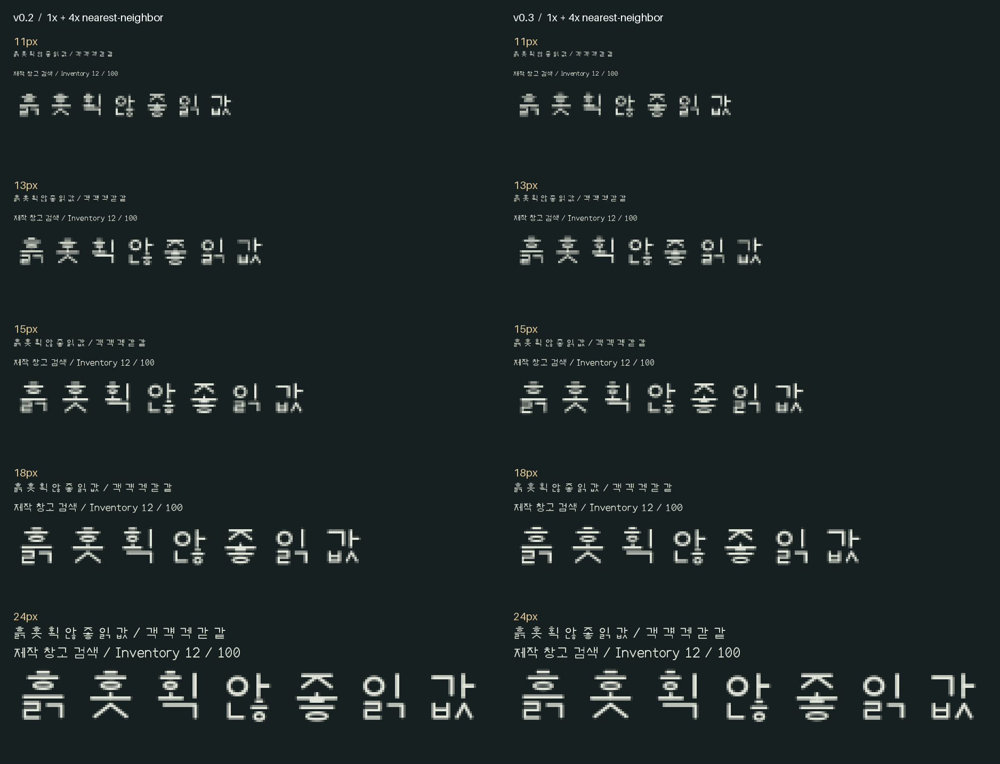

# 방랑 글꼴 — 0.3 시험판

방랑 UI체(Bangrang UI)와 방랑 기록체(Bangrang Chronicle)를 별도로 제작한 무료 글꼴이다. **0.3은 UI체의 작은 한글 획 간격을 보완한 시험판이다.** 기록체의 윤곽과 글자 폭은 0.2를 유지하고 버전 표기를 맞췄다. 작은 크기의 모든 글자가 편하게 읽힌다는 판정은 아직 하지 않는다.

[0.3.0 다운로드](https://github.com/monodass-create/bangrang-fonts/releases/tag/v0.3.0) · [ZIP 바로 받기](https://github.com/monodass-create/bangrang-fonts/releases/download/v0.3.0/Bangrang-Fonts-0.3.0.zip) · [검수 범위와 한계](TESTING.md) · [라이선스](OFL.txt)


## 두 서체

- **방랑 UI체:** 일정한 획과 둥근 끝을 사용한다. 0.3에서 압축된 `ㅎ·ㄹ·ㅂ·ㅌ`, 두 갈래 모음, 받침이 있는 가로·혼합 모음의 초성 `ㅎ` 간격을 보완했다.
- **방랑 기록체:** 가는 가로 획과 두꺼운 세로 획, 작은 끝 장식, 좁은 비례를 사용하는 제목·간판용 서체. 실제 중세 한글 서체를 고증·복원한 것이 아니다.

두 파일 모두 Regular 한 굵기다. 영문은 비례폭, 숫자는 고정폭이며 일부 영문 쌍에 GPOS 커닝을 포함한다. 가짜 볼드와 기울임을 별도 완성 서체로 취급하지 않는다.

**보편적인 최소 사용 크기는 아직 확정하지 않았다.** 특히 11~13px의 복잡한 한글과 축소 UI, 기록체의 작은 본문은 추가 검토가 필요하다. 실제 사용하는 크기·프로그램에서 견본을 먼저 확인한다. 별도 TrueType 힌팅 명령은 포함하지 않는다.



## 포함 범위와 제작 출처

- 한글 완성형 U+AC00~U+D7A3 **11,172자**.
- 영문 대소문자·숫자·ASCII 인쇄 문자 **95자**(공백 포함).
- 현대 한글 자모, 일부 문장부호·화살표·원화 기호. 0.2에서 `× ÷ ± ° ℃ ✓ • é`를 추가했다.
- 전체 코드포인트와 파일 해시는 `build-report.json`에 기록한다.
- 한자·일본어·옛한글·확장 라틴 문자·모든 유니코드 기호를 지원하는 폰트는 아니다.

`source/build_fonts.py`에서 자모와 영문 선의 좌표, 획, 끝 장식, 조합 위치를 직접 정의했다. **기존 폰트의 윤곽을 읽거나 추출·변형하는 코드와 원본 폰트 파일은 포함하지 않는다.** 한글은 초성·중성·종성 조합 규칙으로 생성했다. 사람이 11,172자를 하나씩 별도 디자인하고 검수한 결과라는 뜻은 아니다.

사용 도구는 fontTools와 Pillow다. 도구 자체의 소스·바이너리는 배포물에 포함하지 않는다. 폰트 생성 원본은 fontTools로 TrueType 파일을 만들고, Pillow는 완성 파일의 견본을 렌더링하는 데 사용한다.

## 무료 사용·수정·배포

폰트 파일과 제작 원본은 **SIL Open Font License 1.1**로 제공한다. Reserved Font Name은 지정하지 않는다. 공식 조건은 함께 제공하는 `OFL.txt`를 따른다.

- 개인·상업 작업, 게임·방송·문서·웹사이트에 사용 가능.
- 폰트 수정과 재배포 가능. 폰트와 수정본의 배포에는 OFL 조건과 고지를 유지한다.
- 폰트 자체만 따로 판매하는 것은 허용하지 않는다.
- 이 글꼴로 만든 그림·문서·게임 전체를 OFL로 공개해야 한다는 뜻은 아니다.

근거: [SIL OFL 공식 원문](https://openfontlicense.org/open-font-license-official-text/), [사용 안내](https://openfontlicense.org/how-to-use-ofl-fonts/).

현재 저작자 표기는 프로젝트 명칭인 `The Bangrang Font Project Authors`다. 별도 개인 이름·상표 등록·독점적 권리 보장을 주장하지 않는다.

## 사용

`fonts/`의 TTF 파일을 사용한다. Windows에서는 파일을 열어 설치할 수 있으며, 게임·편집 프로그램에 직접 지정해 사용할 수도 있다. 이번 작업에서 사용자 시스템에 자동 설치하지 않았다.

웹·앱에서 폰트 이름은 `Bangrang UI`, `Bangrang Chronicle`이다. 언어별 이름을 읽는 프로그램은 방랑 UI체·방랑 기록체로 표시할 수 있다. 본문과 제목에 서체를 명시하여 시스템 대체 글꼴과 섞이지 않게 한다.

## 재생성과 검사

Python 환경에 `source/requirements.txt`의 의존성을 설치한 뒤 저장소 폴더에서 실행한다.

```text
python source/build_fonts.py
python source/make_specimens.py
python source/validate_fonts.py
python source/audit_small_sizes.py
```

TTF·빌드 목록, 견본, 파일 회귀 검사, 작은 크기 래스터 검사 결과를 각각 생성한다. 빌드 시각 등으로 재생성 파일의 바이트 해시는 달라질 수 있다. 검사 도구의 통과는 모든 글자의 사람 대상 가독성 검수 완료를 뜻하지 않는다.

## 이번 확인 범위

- 완성형 한글 11,172자, ASCII·일부 기호, 윤곽 중복·범위, 파일 체크섬, 메트릭과 버전 검사 통과.
- 두 서체의 8개 크기 조건, 89,376개 래스터에서 빈 글자와 완전히 같은 회색조 결과 없음. 임계값 비교에서 유사 후보는 남으며 불량 개수나 오독률로 해석하지 않는다.
- Windows 프로세스 안에서 두 TTF를 임시 등록하고 실제 선택된 버전·한글 매핑·해제를 확인. 영구 설치나 재부팅 검사가 아니다.
- 브라우저 대표 문자열, PDF 내장·문자 추출·2쪽 렌더링 확인. Word 등 편집 프로그램에서의 내보내기 검사는 아니다.

전체 음절의 육안 검수, 장시간 읽기, 실제 Windows 125/150/200% 설정, 영구 설치·재시작, 다른 운영체제는 미완료다. 자세한 결과와 원시 자료는 [TESTING.md](TESTING.md)에 있다. [0.2 추가 검수](ADDITIONAL-REVIEW.md)는 당시 상태를 보존한 기록이다.

이 저장소와 배포 묶음은 글꼴 전용이다. 게임 실행 파일·게임 자산은 포함하지 않는다. 사용 중 발견한 문제는 [Issues](https://github.com/monodass-create/bangrang-fonts/issues)에 글자·크기·프로그램·배율과 함께 남길 수 있다.
