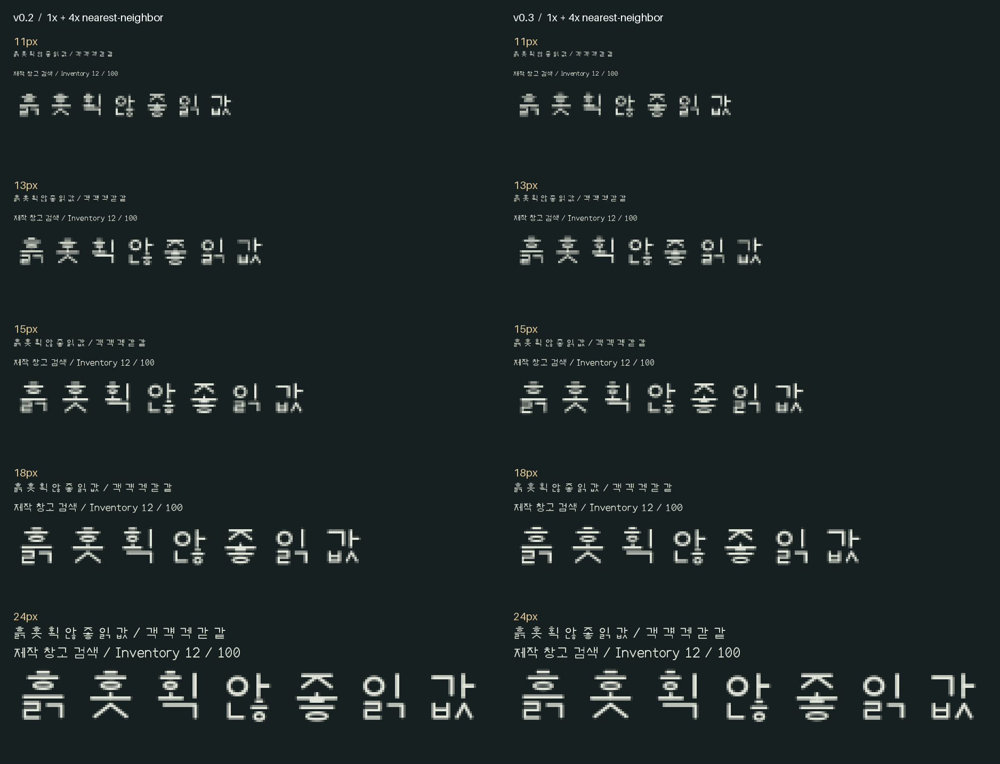
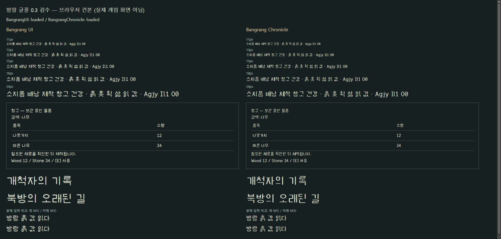

# 0.3 검수 기록 — 2026-11-03

결론: 작은 한글 간격과 대표 표시를 개선했고 아래 파일·실행 검사는 통과했다. **전체 가독성·모든 프로그램의 호환성이 검증된 정식판은 아니다.**

## 글자 수정

UI체의 압축된 `ㅎ·ㄹ·ㅂ·ㅌ` 획 굵기와 두 갈래 모음 간격을 조정했다. 가로·혼합 모음과 받침이 함께 있는 초성 `ㅎ`은 위쪽 여백과 높이를 조정해 아래 모음과의 접촉을 피했다. 기록체 11,410개 글리프의 윤곽·가로 메트릭은 0.2와 동일하다. [비교 기록](reviews/0.3-chronicle-preservation.json)

## 파일과 래스터

[regression-validation.json](regression-validation.json)에 최종 TTF 해시와 검사 결과가 있다. 완성형 한글 11,172자·ASCII·기호, 비어 있거나 중복된 윤곽, 글자 폭, 문장부호, 버전, 전체·테이블 체크섬과 범위를 검사했다. 200px에서 떨어져야 하는 성분은 두 서체 모두 `흙 6 / 홋 5 / 획 6 / 않 6 / 좋 5`다. 큰 크기의 분리는 작은 크기의 가독성 보장이 아니다.

Pillow 12.3.0 / FreeType 2.14.3, 같은 정수 기준점에서 8개 크기 조건의 한글 전체 89,376개 래스터를 비교했다. 모든 조건에서 빈 글자·완전히 같은 회색조 결과는 0이다.

| UI체 크기 | 0.2 임계값 유사 후보 묶음 | 0.3 임계값 유사 후보 묶음 |
|---:|---:|---:|
| 11px | 936 | 855 |
| 13px | 302 | 217 |
| 15px | 0 | 0 |
| 18px | 160 | 71 |
| 24px | 0 | 0 |

기록체 18·24·32px는 양쪽 모두 0이다. 회색조를 128에서 둘로 나누면 가장자리 명도 차이가 사라진다. **후보 묶음 수는 실제 화면의 동일 글자 수, 불량 수, 사용자 오독률이 아니다. 0도 가독성 합격을 뜻하지 않는다.** 크기·기준점·렌더러에 따라 결과는 비단조적으로 달라진다.

원시 자료: [0.2](reviews/0.2-small-size-validation.json), [0.3](small-size-validation.json).

## 브라우저·Windows·PDF

- Opera에서 두 TTF 로드와 대표 한영 문자열의 11·13·15·18·24px, 40px 제목을 확인했다. 대표 NFC/NFD 한글 표본도 비교했다.
- Windows GDI의 프로세스 전용 등록으로 실제 선택된 이름·0.3 버전·11,172자 매핑·해제를 확인했다. [결과](reviews/0.3-windows-private-font-check.json). 사용자 시스템에 영구 설치하지 않았다. API 범위: [AddFontResourceExW](https://learn.microsoft.com/en-us/windows/win32/api/wingdi/nf-wingdi-addfontresourceexw), [GetGlyphIndicesW](https://learn.microsoft.com/en-us/windows/win32/api/wingdi/nf-wingdi-getglyphindicesw).
- [2쪽 문서 견본](specimens/문서견본-0.3.pdf)에 두 TrueType 서체가 내장된 것을 확인했다. 한영 문자열 추출을 검사하고 Poppler로 두 쪽을 렌더링해 잘림과 빈 상자를 확인했다. [결과](reviews/0.3-pdf-embedding-check.json). ReportLab로 만든 PDF의 검사이며 Word의 내보내기 검사는 아니다.

## 미완료 범위

- 모든 한글의 사람 대상 육안 검수, 읽기 속도·오독·장시간 피로도.
- 실제 Windows 125/150/200% 배율 설정에서의 전체 앱 표시·입력.
- 영구 설치·제거·재시작, Word 등 편집 프로그램, 다른 운영체제.
- 별도 TrueType 힌팅. 11~13px 복잡한 한글과 기록체의 작은 본문은 추가 검토가 필요하다.

이전 자료: [0.2 검사](reviews/0.2-TESTING.md), [0.2 추가 검수와 판정 유보](ADDITIONAL-REVIEW.md). 이전 결과를 0.3의 결과로 읽지 않는다.
