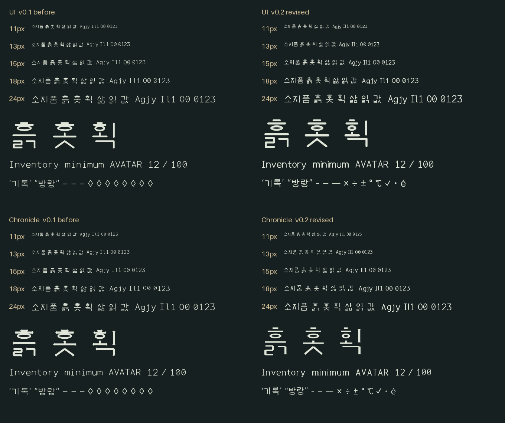
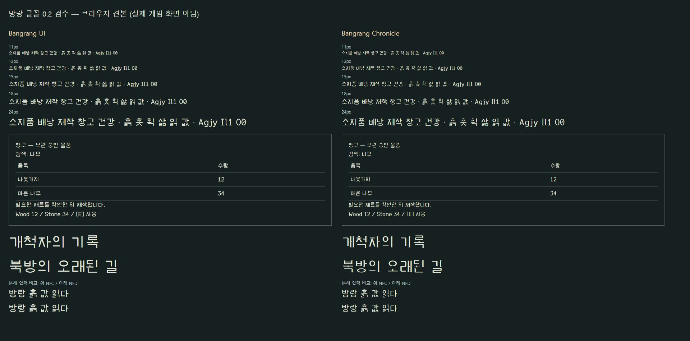

# 0.2 검수 기록

2026-11-03, Windows 환경에서 검수했다. 아래의 용도 적합성은 견본을 본 검수자의 판단이며 사용자 대상 읽기 속도·오독률 측정은 아니다.

## 수정과 재검수

- 0.1에서 붙던 `ㅎ`의 세 요소를 분리했다. 압축된 초성과 받침의 획 굵기, 높이와 원형 폭을 조정하고 한영 혼용의 시각 중심을 맞췄다.
- 영문은 실제 윤곽에 맞춰 글자 폭을 정했다. 숫자는 고정폭을 유지했다. 일부 영문 쌍에 GPOS 커닝을 추가했다.
- 여는/닫는 따옴표, 백틱, 하이픈·en dash·em dash를 구분했다.
- 기록체는 가로·세로 획의 굵기 대비와 좁은 비례를 적용했다.

## 검사 결과

`source/validate_fonts.py`는 다음을 TTF에서 직접 검사하며 결과는 `regression-validation.json`에 있다.

- 현대 한글 11,172자의 매핑·빈 윤곽·동일 윤곽 중복.
- ASCII 및 추가 기호, 영문 비례폭, 숫자 고정폭.
- 따옴표·대시·I/l/1·O/0의 윤곽 구분.
- 내부 버전 값, 전체 파일 및 테이블 체크섬, 글자 윤곽과 메트릭 범위.
- 200px 렌더의 잉크 연결 검사: `흙=6`, `홋=5`, `획=6`, `않=6`, `좋=5`개의 분리된 성분. 이는 크게 렌더링했을 때 원래 떨어져야 하는 획이 분리됐는지 검사하는 것으로, 13px에서도 모두 분리되거나 누구나 쉽게 읽는다는 보증은 아니다.

Pillow/FreeType 견본과 Opera 브라우저에서 대표 한글·영문·숫자를 확인했다. 브라우저에서 11·13·15·18·24px와 40px 제목, `방랑 흙 값 읽다`의 NFC/NFD 표본을 확인했다. 두 원본 TTF의 요청 성공과 실제 표시를 확인했다.

## 사용 판단과 남은 범위

앞서 짧은 UI 13px, 긴 한글 15~18px, 기록체 제목 24px를 권장했지만, **2026-11-03 추가 검수에서 그 수치만으로 사용 적합성을 보장할 근거가 부족함을 확인해 판정을 유보했다.** 작은 크기에서는 일부 획이 다시 연결되고 게임의 축소된 글자에도 가독성 검토가 남았다. [후속 검사와 남은 과제](../ADDITIONAL-REVIEW.md)를 현재 상태로 적용한다. 11px 복잡한 한글 본문과 기록체의 작은 본문 사용은 권장하지 않는다.

전체 음절의 육안 검수, 장시간 읽기 피로도, 다른 운영체제와 문서 편집 프로그램, 별도 TrueType 힌팅은 완료 범위에 포함하지 않는다. 원본 윤곽 제작에 다른 글꼴의 윤곽을 사용하지 않았으며, 검사 도구가 글자 디자인을 대신 검증했다고 주장하지 않는다.
