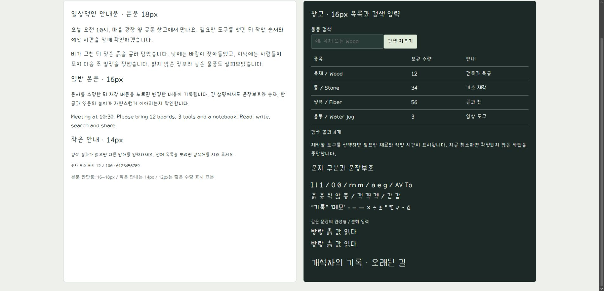
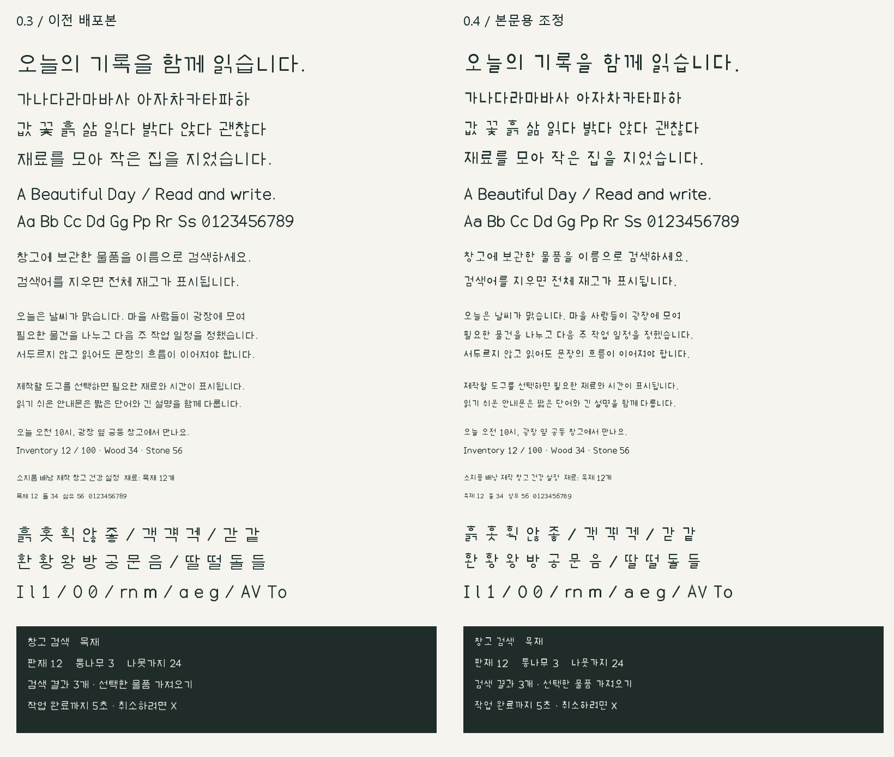

# 방랑 글꼴 — 0.4 사용본

방랑 UI체(Bangrang UI)와 방랑 기록체(Bangrang Chronicle)의 무료 배포 묶음이다. **0.4 UI체는 네모 틀에 억지로 맞춘 자모 비례를 줄이고, 일상적인 안내문과 UI에서 쓸 수 있도록 다듬었다.** 검수한 환경에서는 아래 용도로 사용 가능하다고 판단했다. 이 판단은 대표 화면에 대한 제작 검수이며 사람 대상 가독성 실험 결과는 아니다.

[0.4.0 다운로드](https://github.com/monodass-create/bangrang-fonts/releases/tag/v0.4.0) · [ZIP 바로 받기](https://github.com/monodass-create/bangrang-fonts/releases/download/v0.4.0/Bangrang-Fonts-0.4.0.zip) · [검수 범위와 한계](0.4-TESTING.md) · [라이선스](../OFL.txt)



## 사용 범위

| 서체·용도 | 이번 검수에서 권하는 시작 크기 |
|---|---|
| UI체, 짧은 메뉴·안내 | 14px 이상 |
| UI체, 일반 본문·목록 | 16px 이상 |
| UI체, 긴 설명 | 18px 이상 |
| UI체, 짧은 수량 표시 | 12px 표본 확인; 복잡한 한글 본문에는 비권장 |
| 기록체, 제목·간판 | 24px 이상 |

크기는 검수한 브라우저 화면 기준이다. 렌더러·배율·대비가 바뀌면 다시 확인해야 한다. 문서의 pt와 화면의 px는 같은 단위가 아니다. 11~13px 한글 본문, 모든 프로그램의 기본 글꼴 대체 용도까지 사용 적합성을 인정한 것은 아니다. 두 서체는 Regular 한 굵기다. 별도 굵은 글꼴·기울임·TrueType 힌팅 명령은 포함하지 않는다.

## 0.4에서 바뀐 것

- UI체의 획 끝을 평평하게 정리하고 자모의 폭·높이와 받침 비례를 조정했다. 원형 자모와 사각 자모가 빈 공간을 과도하게 채우지 않게 했다.
- `ㅎ·ㅅ·ㅈ·ㅊ`, 두 갈래 모음과 작은 겹받침을 수정했다. 겹친 선은 합쳐진 윤곽으로 만들고 사각 자모의 내부 공간을 바로잡았다.
- 한글의 가로 폭을 1000에서 940 단위로 줄였다. 영문은 직접 설계한 곡선과 비례폭, 숫자는 같은 폭을 사용한다.
- 기록체의 윤곽·가로 폭·문자 매핑·커닝은 0.3과 같다. 두 서체의 내부 버전만 함께 0.4로 맞췄다.



## 문자 범위와 제작 출처

- 한글 완성형 U+AC00~U+D7A3 11,172자, 현대 한글 자모.
- 영문 대소문자·숫자·ASCII 인쇄 문자 95자(공백 포함), 일부 문장부호·화살표·원화 및 `× ÷ ± ° ℃ ✓ • é`.
- 각 파일의 매핑은 11,409개 코드포인트, 글리프는 11,410개다. 한자·일본어·옛한글·전체 확장 라틴 지원은 포함하지 않는다.

자모·영문·숫자의 좌표와 조합 규칙을 직접 작성했다. `source/ui_shapes.py`는 새 UI 조형, `source/legacy_v03.py`는 프로젝트의 기존 제작 원본, `source/build_fonts.py`는 생성 진입점이다. 외부 글꼴의 윤곽이나 설치된 폰트 파일은 입력으로 쓰지 않는다. 한글 11,172자를 사람이 하나씩 별도 디자인하고 육안 검수했다는 뜻은 아니다.

fontTools와 skia-pathops로 TTF와 윤곽 합집합을 만들고, Pillow로 견본을 렌더링한다. 도구 바이너리는 배포물에 포함하지 않는다.

## 무료 사용·수정·배포

폰트 파일과 제작 원본은 **SIL Open Font License 1.1**로 제공한다. Reserved Font Name은 지정하지 않는다. 동봉한 [OFL.txt](../OFL.txt)를 따른다. 기존 무료 사용·수정·재배포 조건은 유지한다. 저작자 표기는 `The Bangrang Font Project Authors`다. 라이선스 텍스트 취득 경위는 [출처 기록](../LICENSE-PROVENANCE.md)에 있다.

## 사용과 재생성

`fonts/`의 TTF를 프로그램에서 직접 지정하거나 사용자가 설치해서 쓸 수 있다. 이번 검수에서는 시스템 영구 설치를 하지 않았다. 패밀리 이름은 `Bangrang UI`, `Bangrang Chronicle`이며 한국어 이름은 방랑 UI체·방랑 기록체다. 웹에서는 `@font-face`로 각 파일을 지정한다.

Python에 `source/requirements.txt`의 의존성을 설치하고 저장소 폴더에서 실행한다.

```text
python source/build_fonts.py
python source/make_specimens.py
python source/validate_fonts.py
python source/audit_small_sizes.py
```

생성기는 이전 TTF 파일 없이 제작 좌표만으로 두 서체를 재생성한다. 빌드 시각과 체크섬을 제외한 테이블 내용이 배포 파일과 같은지 확인했다. 파일 바이트 해시 자체는 재생성 시 달라질 수 있다.

## 확인과 남은 범위

완성형 한글 전체의 구조·체크섬, 122,892개 크기별 래스터, Windows 임시 글꼴 등록·매핑·해제, 브라우저 입력·본문, PDF 내장·추출·2쪽 출력을 확인했다. 세부 수치와 남은 조건은 [TESTING.md](0.4-TESTING.md)에 있다. 전체 음절의 사람 대상 검수, 장시간 독서, 실제 Windows 배율 변경, Word·다른 운영체제의 설치 검수는 완료하지 않았다. GitHub에서는 검수 범위가 제한된 0.x 사전 배포로 표시한다.

이 저장소는 글꼴 전용이며 게임 실행 파일·게임 자산·사용자 저장은 포함하지 않는다. 문제 제보에는 글자·크기·프로그램·배율을 적어 [Issues](https://github.com/monodass-create/bangrang-fonts/issues)에 남길 수 있다.
